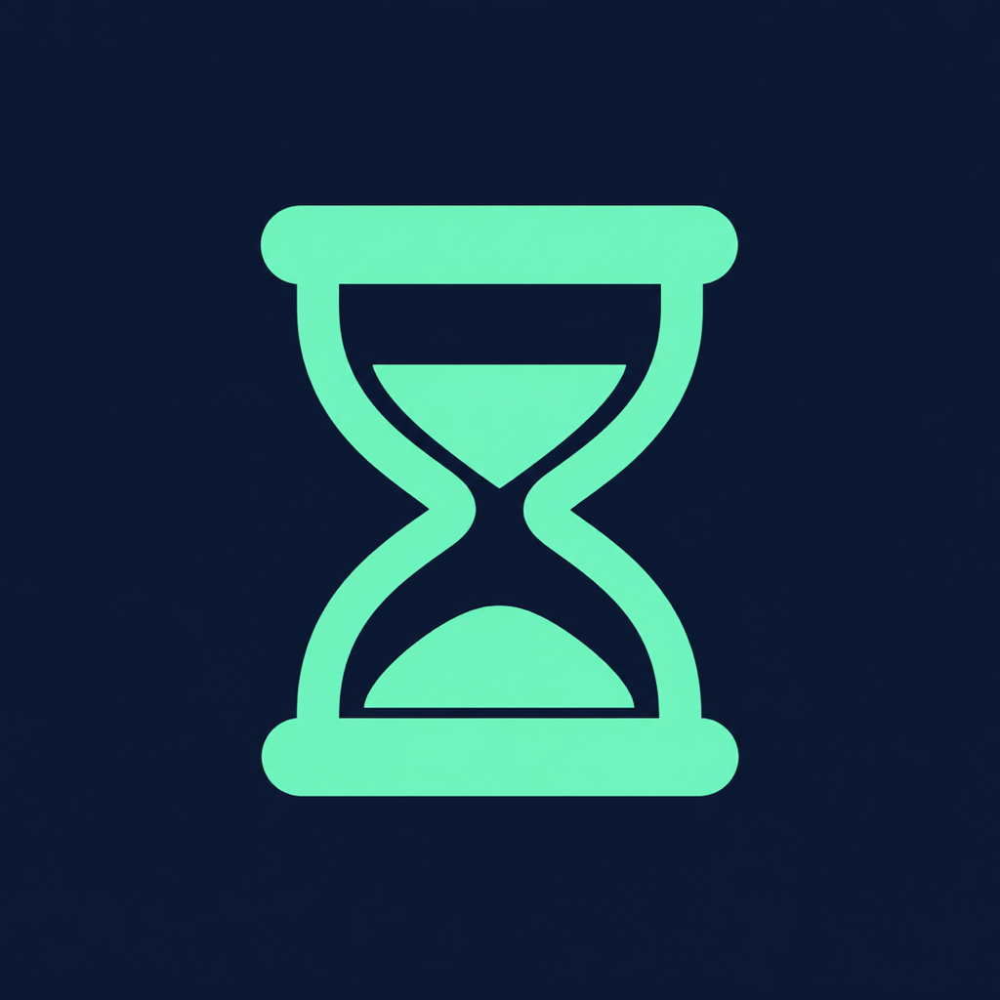

<p align="center">
  
</p>

<h1 align="center">CapTemps</h1>

<p align="center">
  Set a screen time limit. Get one five-minute extension.
  <br>
  A native iPhone app built with SwiftUI and Apple’s Screen Time APIs.
</p>

## How it works

Open CapTemps, tap **Allow CapTemps**, and select an app in Apple’s activity picker. Enter a daily limit in minutes, or enter **0** to block the app immediately. Tap **Lock Rule** to commit.

| Stage | What happens |
| --- | --- |
| **Before the first block** | iOS tracks the selected app against its daily limit. |
| **First block** | iOS shields the app. Tap **+ 5 Minutes** on the shield to extend usage once for that app. |
| **After the extension** | The shield returns after five minutes of use or 24 hours, whichever comes first. The daily limit and extension reset each day. |

CapTemps supports up to 20 app rules. It has no in-app control for removing a locked rule. The shield continues to work while CapTemps is closed, as long as iOS grants it Screen Time access.

## Protection and privacy

With [individual authorization](https://developer.apple.com/documentation/familycontrols/authorizationcenter/requestauthorization%28for%3A%29), the device owner can revoke Screen Time access in iOS Settings. To protect against deletion, set a [Screen Time passcode](https://support.apple.com/en-gb/guide/iphone/iph272b4c4bd/26/ios/26) and set **Settings → Screen Time → Content & Privacy Restrictions → iTunes & App Store Purchases → Deleting Apps** to **Don’t Allow**. This setting applies to all apps. [Apple’s guide to app and purchase restrictions](https://support.apple.com/guide/iphone/block-apps-app-downloads-websites-purchases-iph3ff83f3b1/ios)

CapTemps stores rules and opaque app tokens on the device. The app and its extensions share those rules through an App Group. CapTemps has no account, server, analytics, or network requests.

## Build and run

You need a Mac with Xcode and the iOS 26.4 SDK or newer. The app runs on **iOS 17.4 and later**. Testing Screen Time requires a physical iPhone and an Apple Developer team with the Family Controls capability.

1. Clone this repository. Create the file `Config/Signing.local.xcconfig` with your own values. Git ignores this file.

   ```xcconfig
   DEVELOPMENT_TEAM = YOUR_TEAM_ID
   CAPTEMPS_BUNDLE_ID = com.yourcompany.captemps
   CAPTEMPS_APP_GROUP = group.com.yourcompany.captemps
   ```

2. In your Apple Developer account, enable **Family Controls (Development)** and **App Groups** for the app and its three extensions. The extension identifiers end in `.monitor`, `.shield-configuration`, and `.shield-action`. Assign all four targets to the same App Group. [Apple’s Family Controls setup guide](https://developer.apple.com/documentation/xcode/configuring-family-controls)
3. Open [CapTemps.xcodeproj](CapTemps.xcodeproj), select the **CapTemps** scheme and your iPhone, then choose **Run**. Approve Screen Time access on the device.

The checked-in Xcode project is ready to open. If you change [project.yml](project.yml), regenerate it with `xcodegen generate`. TestFlight and App Store distribution require Apple’s approval for Family Controls on the app and all three extensions. [Apple’s distribution entitlement guide](https://developer.apple.com/documentation/familycontrols/requesting-the-family-controls-entitlement)

## Verify

Run the block and extension state tests on a Mac.

```sh
./Tests/run-tests.sh
```

For an on-device check, choose a test app and give it a one-minute limit. Use the app until the shield appears, tap **+ 5 Minutes** on the shield, then resume using the app. Confirm that the shield returns with only **OK**.
